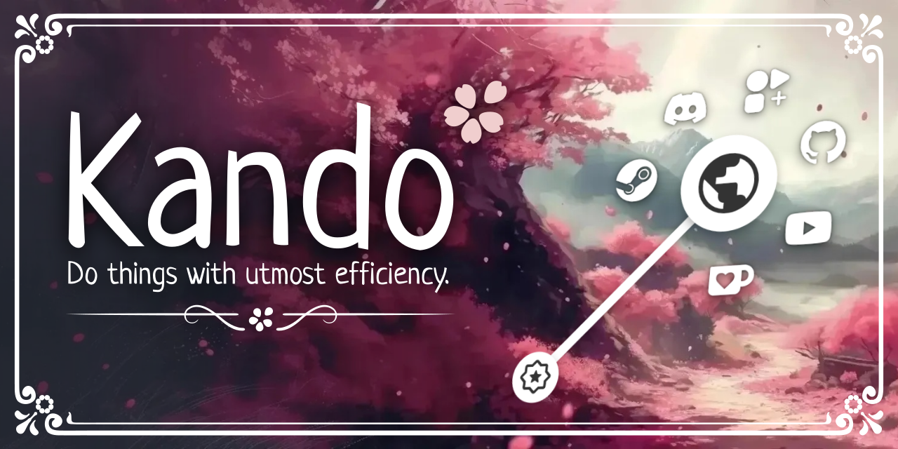
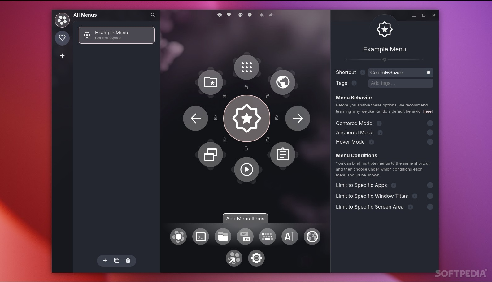

# Kando Radial Menus for Everyday Desktop Actions

Kando Launcher puts chosen actions around the pointer, so a familiar direction can lead to an application, file, or shortcut.
Kando is a cross-platform desktop tool: a kando pie menu organizes commands spatially, a kando desktop pie menu keeps them near your work, and a kando open source pie menu can be inspected and customized.

[](https://kando-launcher.github.io/Kando/)

## Give each direction a purpose

Design a small menu around a repeated activity, such as writing, drawing, or managing a project.
Keep frequently used actions in stable positions so you can learn their directions.
Group related actions in submenus when the root becomes crowded.

For a writing menu, consider a document shortcut, a reference website, and a save action.
For a drawing menu, use shortcuts already supported by your graphics application.
A submenu can hold less frequent operations without giving every command a place on the first ring.

- Choose labels that describe the result of selecting an item.
- Use distinct icons for actions you might otherwise confuse.
- Keep the same task in the same direction when revising a familiar menu.
- Separate commands that launch an app from commands intended for an app that is already active.

Menu organization is handled by [MenuList.tsx](src/settings-renderer/components/menu-list/MenuList.tsx).
The editor preview is implemented in [MenuPreview.tsx](src/settings-renderer/components/menu-preview/MenuPreview.tsx).
Item properties are edited through [Properties.tsx](src/settings-renderer/components/menu-properties/Properties.tsx).



Menus can also depend on context.
Use application or window conditions when the same trigger should serve different workspaces.
The available condition controls are implemented in [MenuConditions.tsx](src/settings-renderer/components/menu-properties/MenuConditions.tsx).

## Decide what a selection should do

An item can execute a workflow containing one or more actions.
Choose the action that matches the target: a file, a website, a shell command, or keyboard input.
The selection workflow editor is [WorkflowEditor.tsx](src/settings-renderer/components/menu-properties/WorkflowEditor.tsx), with action ordering handled by [ActionList.tsx](src/settings-renderer/components/menu-properties/ActionList.tsx).

Opening a document uses [open-file.ts](src/main/actions/open-file.ts) and the system's associated application.
A website or another supported URI is handled by [open-uri.ts](src/main/actions/open-uri.ts).
For example, this workflow fragment opens Kando's usage guide:

```json
{
  "actions": [
    {
      "type": "open-uri",
      "uri": "https://kando.menu/usage/"
    }
  ]
}
```

This is a workflow object for an item's selection behavior, not a complete menu configuration.
Its action fields follow the definitions in [menu-settings-v2.ts](src/common/settings-schemata/menu-settings-v2.ts).

For an application launch with arguments, use Execute Command; its implementation is [execute-command.ts](src/main/actions/execute-command.ts).
For one keyboard combination, use Simulate Hotkey, implemented in [simulate-hotkey.ts](src/main/actions/simulate-hotkey.ts).
For a sequence of key presses and releases, use Execute Macro, implemented in [execute-macro.ts](src/main/actions/execute-macro.ts).

Check which application has focus before assigning a shortcut that changes its contents.
A save shortcut, for example, only has the intended meaning when the target application handles it as expected.
If a sequence needs a pause, the Delay action in [delay.ts](src/main/actions/delay.ts) accepts a duration in seconds.
Workflow execution is coordinated by [workflow-executor.ts](src/main/workflow-executor.ts).

## Make the menu easy to recognize

Appearance should help you distinguish the active item and its neighbors.
Choose a theme whose labels remain readable over the desktop backgrounds you actually use.
Kando supports menu styling, configurable theme colors, and separate sound themes.

The Default theme metadata is in [theme.json5](assets/menu-themes/default/theme.json5).
Its layout rules are in [theme.css](assets/menu-themes/default/theme.css).
In a customized copy of that theme, these CSS properties can adjust the spacing and child item size:

```css
.menu-node {
  --child-distance: 115px;
  --child-size: 54px;
}
```

This override uses properties consumed by the Default theme; other themes may use different layout rules.
The menu theme renderer is [menu-theme.ts](src/menu-renderer/menu-theme.ts).
Audio feedback is managed separately by [sound-theme.ts](src/menu-renderer/sound-theme.ts).



## Choose a way to select

The example menu uses **Ctrl+Space** as its activation shortcut.
If another application already uses it, open Kando's settings through the tray icon and assign a different trigger.
Once the menu is visible, choose the interaction that fits your input device and familiarity with the layout.

| Mode | Selection mechanism | Useful when | Main consideration |
| --- | --- | --- | --- |
| Point and Click | Click within an item's wedge | Learning a menu or reading labels | The wedge is selectable beyond the icon |
| Marking | Drag, then pause or change direction | Following a familiar submenu path | Clear turns are easier to interpret |
| Turbo | Navigate while holding an activation modifier | Repeating learned directional selections | Releasing the modifier selects the current item |
| Hover | Move over an item and wait | Using a well-practiced layout | Enable per menu and consider accidental activation |

Pointer interaction is implemented in [pointer-input.ts](src/menu-renderer/input-methods/pointer-input.ts).
Turn and pause recognition is handled by [gesture-detector.ts](src/menu-renderer/input-methods/gesture-detector.ts).
The visible selection regions are drawn by [selection-wedges.ts](src/menu-renderer/selection-wedges.ts).
Controller navigation has a separate implementation in [gamepad-input.ts](src/menu-renderer/input-methods/gamepad-input.ts).

Begin with deliberate selections before relying on a memorized gesture.
A consistent layout matters more than adding every possible action to the menu.

## Open a named menu from another tool

Kando's CLI can connect a menu to a script or an external input remapper.
Suppose you have created a menu named **Writing**.
With the Kando executable available as **kando**, run these commands independently for the indicated tasks:

```bash
kando --menu "Writing"
kando --settings
kando --reload-menu-theme
```

The first command requests the named menu, the second opens settings, and the third reloads the current menu theme.
The command parser is defined in [index.ts](src/main/index.ts).
A menu request still respects context conditions; its name alone does not bypass them.
If Kando is already running, supported requests are forwarded to the existing instance.

Opening menus from mouse buttons or touch gestures can require an external remapping tool.
That activation step is distinct from navigating the menu with a pointer, stylus, touch, or controller.

## Keep platform differences in view

Kando supports Windows, macOS, and Linux, but system integration depends on the operating system and desktop session.
On Linux, X11 and individual Wayland environments use different integration paths.
Backend selection is implemented in [index.ts](src/main/backends/index.ts).

When moving a menu between computers, review file paths, executable names, keyboard shortcuts, and available applications.
Retain the menu's organization while adapting actions to the destination system.
The examples above were checked against documentation and the supplied source; they were not executed.

## Related Search Terms

Kando Launcher, Kando, kando pie menu, kando desktop pie menu, kando open source pie menu, pie-menu, marking-menu, gestures, cross-platform, windows, macos, linux, electron, ux-design
